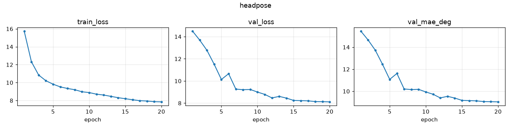
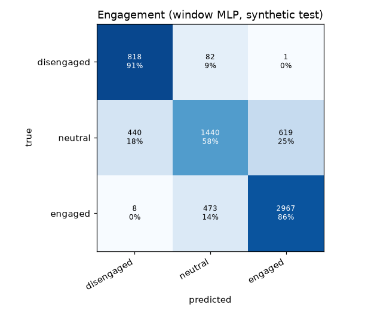
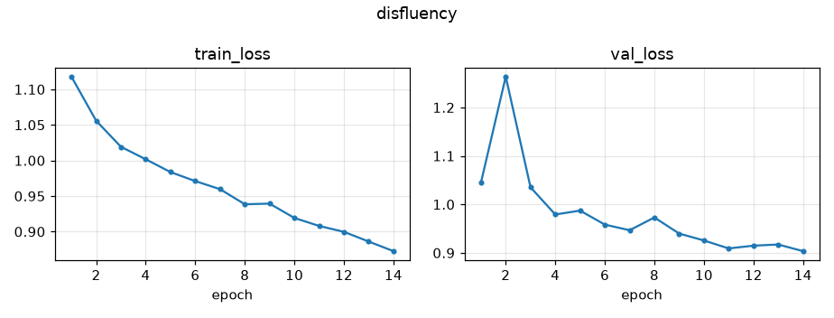
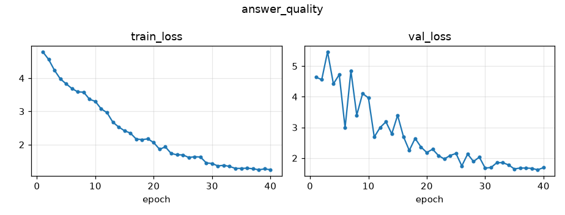
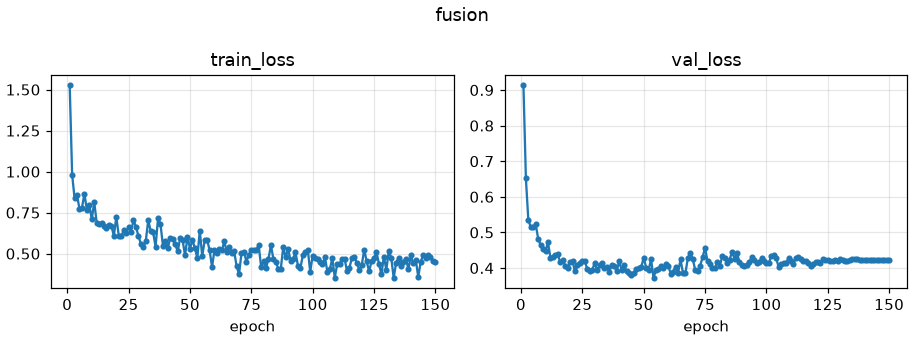

# MBAS model report

_Generated 2026-10-25 by `python -m tools.model_report`._

Every model was defined in PyTorch and trained from random initialisation on public raw datasets, the synthetic dataset and (when labelled) our own recordings. No pre-trained weights or AI APIs are used.

## Summary

| Stage | Model | Epochs | Headline test result |
| --- | --- | ---: | --- |
| 4 | Face + landmark detector | - | not trained yet |
| 4 | Gaze + iris CNN | - | not trained yet |
| 5 | Head-pose CNN | 20 | MAE yaw/pitch/roll 10.753/10.697/5.484 deg |
| 5 | Engagement MLP + attention score | - | engagement macro-F1 0.7464, attention MAE 3.156 |
| 5 | Engagement CNN-GRU | - | not trained yet |
| 6 | Voice activity detector | - | not trained yet |
| 6 | Conformer-CTC ASR | - | not trained yet |
| 7 | Disfluency CRNN | 14 | filler F1 0.6804, repetition F1 0.4033, prolongation F1 0.4618, block F1 0.293 |
| 7 | Speaking pattern + hesitation index | - | pattern macro-F1 0.8098, hesitation MAE 4.317 |
| 8 | Answer-quality transformer | 40 | quality QWK 0.8574 vs TF-IDF 0.7726 |
| 8 | Multimodal fusion | 150 | effectiveness MAE 5.876, follow-up F1 0.9586 |
| 8 | Meeting head | - | AMI balance MAE 0.0317 |

---

## Stage 5: Head-pose CNN

## Task

Yaw, pitch and roll of the candidate's head from a 64x64 face crop; input to the gaze CNN, the attention score and the head-movement features.

## Architecture

| | |
| --- | --- |
| layers | 4 conv blocks (32-64-128-128) + global average pool + MLP 64 -> 3 |
| parameters | 591,331 |
| output | degrees (tanh-free, scaled x30) |

## Training data

20700 WIDER FACE train faces >= 40 px with RetinaFace landmarks; labels from solvePnP on a generic 5-point 3-D face (ml/vision/headpose/geometry.py). Box jitter, photometric augmentation, horizontal flip (yaw and roll negated). Split by image.

## Results (held-out images)

| | |
| --- | --- |
| MAE yaw | 10.753 deg |
| MAE pitch | 10.697 deg |
| MAE roll | 5.484 deg |
| mean-pose baseline (yaw/pitch/roll) | {'yaw': 26.008, 'pitch': 16.434, 'roll': 10.485} |
| CPU latency | 7.669 ms |

## Limitations

- Labels are geometric estimates from a generic face model, so errors are measured against pseudo-labels; absolute accuracy against ground truth needs our scripted 'look at camera' segments (0, 0, 0) or a calibrated rig.
- Pitch from 5 landmarks is the least reliable angle (depends on the face's proportions).

Metrics: `docs/metrics/headpose.json`

---

## Stage 5: Engagement MLP + attention score

## Task

Per 5 s window: engagement class (fallback until the CNN-GRU is trained on video) and a 0-100 attention score with an on/off-screen decision, from features our models compute.

## Inputs

| | |
| --- | --- |
| engagement | face_present_ratio, on_screen_ratio, glance_away_count, saccade_rate_hz, fixation_duration_mean_s, blink_rate_per_min, reading_pattern_flag, gaze_yaw_std_deg, gaze_pitch_std_deg, iris_movement_std, head_yaw_abs_deg, head_pitch_abs_deg, head_yaw_std_deg, head_pitch_std_deg, face_motion_energy, mouth_open_ratio, vad_speech_ratio, interviewer_speech_ratio, state_listening, state_thinking, state_answering |
| attention | face_present_ratio, on_screen_ratio, glance_away_count, saccade_rate_hz, blink_rate_per_min, reading_pattern_flag, head_yaw_abs_deg, head_pitch_abs_deg, head_yaw_std_deg, head_pitch_std_deg + engagement probabilities (out-of-fold in training) |

## Models

| | |
| --- | --- |
| engagement | MLP 2 x 64, dropout 0.2, class-weighted cross-entropy |
| attention | linear (logistic + linear regression) vs 2-layer MLP; best by test MAE: mlp |

## Data

synthetic windows, person-wise split (32881 train / 6505 val / 6848 test) - SYNTHETIC: the simulator designed these relationships, so scores are optimistic.

## Results (test)

| | |
| --- | --- |
| engagement macro-F1 | 0.7464 |
| engagement majority baseline | 0.1782 |
| attention linear MAE | 3.79 |
| attention mlp MAE | 3.156 |
| attention linear on/off F1 | 0.94 |
| attention mlp on/off F1 | 0.9501 |
| confusion matrices | docs/metrics/engagement_window_cm.png, docs/metrics/attention_onoff_cm.png |

Metrics: `docs/metrics/window_models.json`

---

## Stage 7: Disfluency CRNN

## Task

Audio-side hesitation: filled pause, repetition, prolongation, block in each 3 s window of the candidate's speech (counts feed the behaviour JSON and the hesitation index).

## Architecture

| | |
| --- | --- |
| front end | 80-band log-mel, per-clip normalisation, SpecAugment (train) |
| network | 4 conv blocks -> BiGRU(96) -> attention pooling -> 4 sigmoid outputs |
| parameters | 1,008,357 |

## Training data

SEP-28k (podcast clips, label present when >= 2 of 3 annotators marked it), split by episode; class-balanced BCE (pos_weight). Our hesitation spans are added once labelled.

## Results (test episodes)

| | |
| --- | --- |
| filler F1 / AUC | 0.6804 / 0.8667 (always-yes F1 0.3966) |
| repetition F1 / AUC | 0.4033 / 0.7019 (always-yes F1 0.337) |
| prolongation F1 / AUC | 0.4618 / 0.8521 (always-yes F1 0.1728) |
| block F1 / AUC | 0.293 / 0.6723 (always-yes F1 0.2135) |

## Limitations

- SEP-28k is mostly people who stutter, recorded on podcasts; Indian-English fillers such as 'matlab' are covered by the text-side rules until our labelled answers are added.
- Blocks and prolongations are rare in interviews; their F1 is reported for completeness.

Metrics: `docs/metrics/disfluency.json`

---

## Stage 7: Speaking pattern + hesitation index

## Task

Per answer: speaking pattern (confident / balanced / hesitant / rushed / monotone) and a 0-100 hesitation index; inputs come from the pause model, prosody extractor and text/audio hesitation.

## Models

| | |
| --- | --- |
| speaking pattern | MLP 2 x 64, class-weighted CE |
| hesitation index | 100 * sigmoid(b + sum softplus(w_i) x_i) (monotone, interpretable) vs MLP |

## Data

synthetic answers, person-wise split (2255 / 451 / 473) - SYNTHETIC; re-train on our labels with the same script once sessions are labelled.

## Results (test)

| | |
| --- | --- |
| speaking pattern macro-F1 | 0.8098 |
| majority baseline | 0.1129 |
| hesitation index MAE (weighted sum) | 4.317 |
| hesitation index MAE (MLP) | 2.796 |
| mean baseline MAE | 13.84 |

## Largest hesitation weights

filler_rate_per_100w 0.33, disfluency_rate_per_100w 0.22, prolongation_count 0.12, response_latency_s 0.11, repetition_count 0.10

## Text hesitation rules vs dataset counts (Pearson r)

| | |
| --- | --- |
| filler_count | 0.8183 |
| repetition_count | 0.9604 |
| restart_count | 0.9434 |
| hedge_count | 0.8684 |

Metrics: `docs/metrics/behaviour.json`

---

## Stage 8: Answer-quality transformer

## Task

From the question and the answer transcript: relevance 0-1, quality 1-5, STAR components (behavioural questions), completeness, follow-up yes/no and reason.

## Architecture

| | |
| --- | --- |
| encoder | 4 pre-norm transformer layers, d_model 256, 4 heads, FF 1024 |
| input | [CLS] question [SEP] answer, SentencePiece answer vocabulary (ours), segment embeddings |
| parameters | 3,520,018 |

## Training data

synthetic labelled answers (person-wise split) + synthetic off-topic pairs (question with another question's answer). SYNTHETIC for now.

## Results (test) - transformer vs TF-IDF baseline

| | |
| --- | --- |
| relevance_mae | 0.0672 vs 0.0719 |
| relevance_r | 0.9477 vs 0.9248 |
| quality_accuracy | 0.6913 vs 0.5814 |
| quality_mae | 0.3907 vs 0.4546 |
| quality_qwk | 0.8574 vs 0.7726 |
| follow_up_f1 | 0.8829 vs 0.8523 |
| reason_macro_f1 | 0.5485 vs 0.4981 |

## Off-topic check

mean predicted relevance 0.0982, 97% flagged for follow-up

## Notes

- The synthetic answers are built from key-point sentences, so bag-of-words baselines are strong; the gap to the transformer should be re-measured on our transcripts.
- MIT Interview transcripts (on request) are added through answers_table once converted.

Metrics: `docs/metrics/answer_quality.json`

---

## Stage 8: Multimodal fusion

## Task

Communication effectiveness 0-100 with clarity, confidence, engagement, relevance and fluency sub-scores, follow-up yes/no + reason, with the top-3 reasons for every score.

## Architecture

| | |
| --- | --- |
| encoders | one MLP per modality (vision, prosody, hesitation, content, conversation) -> 64-d token |
| fusion | learned query, 4-head attention over modality tokens (weights = modality importance) + mean pool |
| heads | 6 sigmoid scores, follow-up logit, 6-way reason |
| parameters | 85,837 |
| regularisation | dropout 0.3, modality dropout 0.15 |

## Data

synthetic answers, person-wise split; content modality = out-of-fold answer-model outputs. SYNTHETIC for now: retrain on MIT Interview ratings + our labels with the same script.

## Ablation (test, effectiveness MAE / follow-up F1)

| | |
| --- | --- |
| video only | 10.712 / 0.7474 |
| audio only | 7.818 / 0.7896 |
| text only | 8.169 / 0.8765 |
| all modalities | 5.876 / 0.9586 |

## Baselines

| | |
| --- | --- |
| ridge_effectiveness_mae | 5.709 |
| mean_effectiveness_mae | 12.486 |

## All modalities (test)

| | |
| --- | --- |
| effectiveness MAE | 5.876 |
| Pearson r | 0.8917 |
| follow-up F1 | 0.9586 |
| reason macro-F1 | 0.6367 |
| mean modality attention | {'vision': 0.20469999313354492, 'prosody': 0.05979999899864197, 'hesitation': 0.10189999639987946, 'content': 0.5889999866485596, 'conversation': 0.044599998742341995} |

## Explanations

Shapley values by permutation sampling (48 orderings) -> templates (ml/fusion/explain.py); 100% of test answers get 3 reasons (examples: docs/metrics/fusion_explanations.json).

## Use

Decision support for the interviewer, never an automatic reject.

Metrics: `docs/metrics/fusion.json`

---

## Stage 8: Meeting head

## Task

Meeting mode: engagement 0-1 and contribution balance 0-1 per participant, from talk share, relative turn features and (camera on) on-screen ratio, face motion, head movement, multitasking share.

## Model

MLP 2 x 32 on standardised features; trained with camera-off copies so it works audio-only.

## Data

synthetic meetings (participants split person-wise); generalisation test on AMI (171 real meetings).

## Results

| | |
| --- | --- |
| synthetic test engagement MAE | 0.0381 |
| synthetic test balance MAE | 0.0283 |
| AMI balance MAE (relative features) | 0.0317 |
| AMI balance MAE (absolute features, first try) | 0.1201 |

## Finding

Absolute turn rate and turn length did not transfer from the simulator to real meetings (AMI turns are 3-6x shorter); within-meeting relative turn features fixed most of the drop.

Metrics: `docs/metrics/meeting_head.json`

---

## Failure cases and limitations

- Webcam vision models are pre-trained on public photos (WIDER, MPIIGaze); dim and backlit webcams and strong glasses reflections are the main failure cases until our recordings are added.
- The answer, behaviour and fusion models are trained on the SYNTHETIC dataset; their scores show that the pipeline learns, not how well it rates real candidates. Re-train on our labelled sessions with the same scripts.
- The ASR is trained on ~100 h of read English; spontaneous Indian-English interview speech is harder (see the per-accent WER rows once our sessions are transcribed).
- Bias check across gender, accent and glasses: docs/bias_check.md.
