# MBAS model report

_Generated 2026-11-19 by `python -m tools.model_report`._

Every model was defined in PyTorch and trained from random initialisation on public raw datasets, the synthetic dataset and (when labelled) our own recordings. No pre-trained weights or AI APIs are used.

## Summary

| Stage | Model | Epochs | Headline test result |
| --- | --- | ---: | --- |
| 4 | Face + landmark detector | 60 | webcam-crop AP@0.5 0.8574, recall 0.7347 |
| 4 | Gaze + iris CNN | 25 | angular error 5.284 deg (baseline 9.635) |
| 5 | Head-pose CNN | 20 | MAE yaw/pitch/roll 10.753/10.697/5.484 deg |
| 5 | Engagement MLP + attention score | - | engagement macro-F1 0.7464, attention MAE 3.156 |
| 5 | Engagement CNN-GRU | - | not trained yet |
| 6 | Voice activity detector | 8 | frame F1 0.9547 (energy baseline 0.7818) |
| 6 | Conformer-CTC ASR | 40 | librispeech_test_clean: 0.159/0.1573/0.1366 (WER greedy/beam/beam+LM) |
| 7 | Disfluency CRNN | 25 | filler F1 0.6935, repetition F1 0.4253, prolongation F1 0.4463, block F1 0.3034 |
| 7 | Speaking pattern + hesitation index | - | pattern macro-F1 0.8098, hesitation MAE 4.317 |
| 8 | Answer-quality transformer | 40 | quality QWK 0.8574 vs TF-IDF 0.7726 |
| 8 | Multimodal fusion | 150 | effectiveness MAE 5.876, follow-up F1 0.9586 |
| 8 | Meeting head | - | AMI balance MAE 0.0317 |

---

## Stage 4: Face + landmark detector

## Task

Detect faces and 5 landmarks (eyes, nose, mouth corners) in a webcam frame; eye landmarks feed the eye-crop extractor for the gaze/iris CNN.

## Architecture

| | |
| --- | --- |
| type | single-shot, BlazeBlocks (depthwise 5x5 + pointwise, residual) |
| input | 128x128 RGB, letterboxed |
| anchors | 896 (16x16 x 2 + 8x8 x 6), square |
| parameters | 382,740 |
| heads | face logit, box (cx, cy, w, h), 5 key points |

## Training data

WIDER FACE train (90%) with RetinaFace 5-point landmarks; random face-centred square crops (1.4-6x face size), photometric jitter, horizontal flip with landmark swap.

## Training

| | |
| --- | --- |
| epochs | 60 |
| batch | 64 |
| optimiser | AdamW lr 0.002, cosine, warm-up 500 |
| loss | focal (alpha .25, gamma 2) + smooth-L1 box + 0.5 x smooth-L1 landmarks |
| curves | docs/metrics/face_detector_curves.png |
| logs | runs/face_detector (TensorBoard) |

## Results (WIDER val = our test split)

| | |
| --- | --- |
| webcam-style crops AP@0.5 | 0.8574 |
| webcam-style crops recall@0.5 | 0.7347 |
| full images AP@0.5 (faces >= 8% of input) | 0.5345 |
| landmark NME (val, inter-ocular) | 0.3792 |
| CPU latency (torch, 4 threads) | 10.546 ms (94.8 fps) |
| PR curve | docs/metrics/face_detector_pr.png |

## Limitations

- Faces smaller than ~10 px at 128 px input are not detected (not needed for webcams).
- Not yet fine-tuned on our own frames: the 1,500-frame key-point set from our recordings is the next step once sessions exist (FaceDataset accepts the same format).
- WIDER is crowd/event photography; webcam lighting (backlit, dim) is covered only by photometric augmentation until our recordings are added.

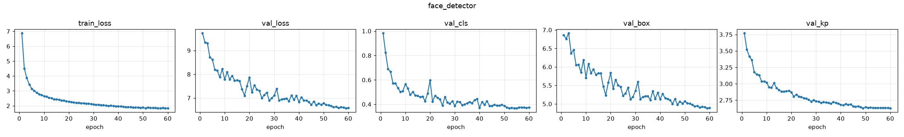

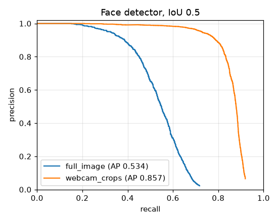

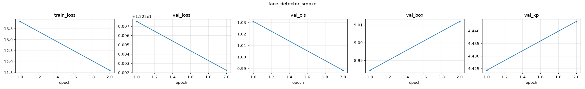

Metrics: `docs/metrics/face_detector.json`

---

## Stage 4: Gaze + iris CNN

## Task

Estimate gaze direction (pitch, yaw), the iris centre in each eye crop and on/off-screen from two 36x60 eye crops plus head pose. Feeds attention signals: off-screen %, glance-away count, saccade rate, blink rate, reading-pattern flag (ml/vision/gaze_iris/signals.py).

## Architecture

| | |
| --- | --- |
| eye encoder | 4 conv blocks (32-64-128-128), shared by both eyes |
| trunk | concat(2 x 128 + head pose 2) -> 256 -> 128 |
| heads | gaze 2, iris 4, on-screen 1 |
| parameters | 1,141,287 |

## Training data

MPIIGaze normalised eye images, person-wise split (train/val/test persons in data/splits/public/mpiigaze). Flip augmentation swaps eyes and mirrors yaw.

## Iris targets

eyeball model fitted to a classical dark-pupil detector: {'ax': 0.48728672809456614, 'bx': -0.22662725765336847, 'ay': 0.40219017641269905, 'by': -0.1708512532725962, 'n': 11842, 'corr_x_yaw': -0.307, 'corr_y_pitch': -0.211}

## Training

| | |
| --- | --- |
| epochs | 25 |
| batch | 256 |
| loss | L1 gaze + 0.5 L1 iris + BCE on-screen (masked) |
| curves | docs/metrics/gaze_iris_curves.png |

## Results (held-out persons)

| | |
| --- | --- |
| mean angular error | 5.284 deg |
| median angular error | 5.188 deg |
| mean-gaze baseline | 9.635 deg |
| on/off-screen F1 | pending our labelled windows (see note) |
| CPU latency | 36.602 ms |

## Limitations

- MPIIGaze crops are perspective-normalised; our webcam crops use roll correction only, so a domain gap remains until fine-tuning on our 60 s calibration captures.
- On/off-screen in the live system: per-session calibration box on predicted gaze (signals.ScreenCalibration), not the untrained on-screen head.
- Glasses with strong reflections and very dim light reduce accuracy (bias check, Stage 10).

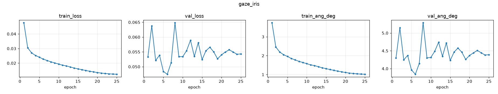

Metrics: `docs/metrics/gaze_iris.json`

---

## Stage 5: Head-pose CNN

## Task

Yaw, pitch and roll of the candidate's head from a 64x64 face crop; input to the gaze CNN, the attention score and the head-movement features.

## Architecture

| | |
| --- | --- |
| layers | 4 conv blocks (32-64-128-128) + global average pool + MLP 64 -> 3 |
| parameters | 591,331 |
| output | degrees (tanh-free, scaled x30) |

## Training data

20700 WIDER FACE train faces >= 40 px with RetinaFace landmarks; labels from solvePnP on a generic 5-point 3-D face (ml/vision/headpose/geometry.py). Box jitter, photometric augmentation, horizontal flip (yaw and roll negated). Split by image.

## Results (held-out images)

| | |
| --- | --- |
| MAE yaw | 10.753 deg |
| MAE pitch | 10.697 deg |
| MAE roll | 5.484 deg |
| mean-pose baseline (yaw/pitch/roll) | {'yaw': 26.008, 'pitch': 16.434, 'roll': 10.485} |
| CPU latency | 7.669 ms |

## Limitations

- Labels are geometric estimates from a generic face model, so errors are measured against pseudo-labels; absolute accuracy against ground truth needs our scripted 'look at camera' segments (0, 0, 0) or a calibrated rig.
- Pitch from 5 landmarks is the least reliable angle (depends on the face's proportions).

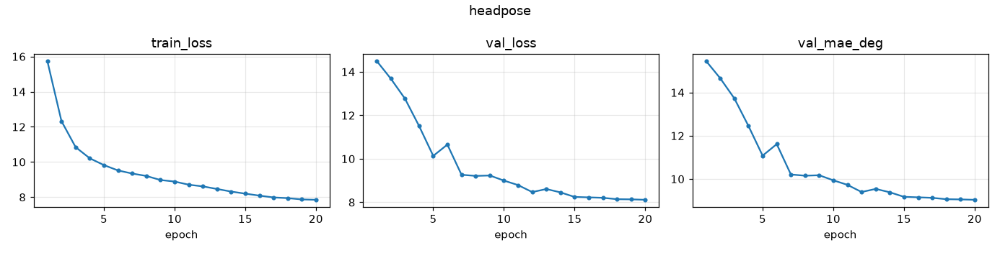

Metrics: `docs/metrics/headpose.json`

---

## Stage 5: Engagement MLP + attention score

## Task

Per 5 s window: engagement class (fallback until the CNN-GRU is trained on video) and a 0-100 attention score with an on/off-screen decision, from features our models compute.

## Inputs

| | |
| --- | --- |
| engagement | face_present_ratio, on_screen_ratio, glance_away_count, saccade_rate_hz, fixation_duration_mean_s, blink_rate_per_min, reading_pattern_flag, gaze_yaw_std_deg, gaze_pitch_std_deg, iris_movement_std, head_yaw_abs_deg, head_pitch_abs_deg, head_yaw_std_deg, head_pitch_std_deg, face_motion_energy, mouth_open_ratio, vad_speech_ratio, interviewer_speech_ratio, state_listening, state_thinking, state_answering |
| attention | face_present_ratio, on_screen_ratio, glance_away_count, saccade_rate_hz, blink_rate_per_min, reading_pattern_flag, head_yaw_abs_deg, head_pitch_abs_deg, head_yaw_std_deg, head_pitch_std_deg + engagement probabilities (out-of-fold in training) |

## Models

| | |
| --- | --- |
| engagement | MLP 2 x 64, dropout 0.2, class-weighted cross-entropy |
| attention | linear (logistic + linear regression) vs 2-layer MLP; best by test MAE: mlp |

## Data

synthetic windows, person-wise split (32881 train / 6505 val / 6848 test) - SYNTHETIC: the simulator designed these relationships, so scores are optimistic.

## Results (test)

| | |
| --- | --- |
| engagement macro-F1 | 0.7464 |
| engagement majority baseline | 0.1782 |
| attention linear MAE | 3.79 |
| attention mlp MAE | 3.156 |
| attention linear on/off F1 | 0.94 |
| attention mlp on/off F1 | 0.9501 |
| confusion matrices | docs/metrics/engagement_window_cm.png, docs/metrics/attention_onoff_cm.png |

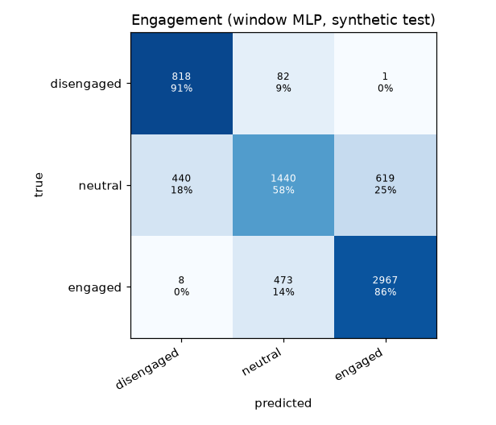

Metrics: `docs/metrics/window_models.json`

---

## Stage 6: Voice activity detector

## Task

Speech / non-speech every 10 ms on each participant's audio track; feeds the ASR, the pause model and the conversation analyser.

## Architecture

| | |
| --- | --- |
| front end | 40-band log-mel (25 ms / 10 ms) |
| network | 4 dilated 1-D conv layers (64 ch, receptive field ~330 ms) |
| post-processing | hysteresis 0.5 / 0.35, 200 ms hangover, 120 ms minimum speech |
| parameters | 45,377 |

## Training data

LibriSpeech (+ Common Voice) utterances placed with random silences in 8 s mixtures, mixed with recorded noise (data/raw/noise) or generated room noise (white/pink/brown/hum/babble) at 0-25 dB SNR; targets from the clean utterances' energy mask.

## Results (test mixtures, unseen speakers)

| | |
| --- | --- |
| frame F1 raw | 0.9726 |
| frame F1 smoothed | 0.9547 |
| energy-threshold baseline | 0.7818 |
| CPU latency per 640 ms chunk | 3.473 ms |

## Limitations

Targets are energy masks of clean read speech; our sessions (spontaneous speech, laptop mics) are the real test once labelled; record lab/hostel noise into data/raw/noise to replace generated noise.

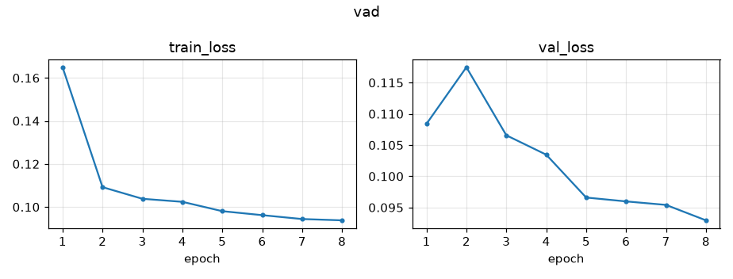

Metrics: `docs/metrics/vad.json`

---

## Stage 6: Conformer-CTC ASR

## Task

Streaming transcription of each participant's audio track (< 2 s delay); word timestamps for the transcript panel, the pause model and the fusion features.

## Architecture

| | |
| --- | --- |
| front end | 80-band log-mel, per-utterance CMVN, SpecAugment (2 freq x 27, 10 time x 5%) |
| encoder | Conv2d x2 subsampling (40 ms) + 12 Conformer blocks, d_model 176, 4 heads, conv kernel 31 |
| output | CTC over our SentencePiece vocabulary (1000 pieces) |
| parameters | 9,724,648 |

## Training

LibriSpeech train-clean-100 (+ Common Voice Indian English + our transcripts when available); speed perturbation 0.9/1.0/1.1, Noam schedule, fp16, dynamic chunk training (streaming), checkpoint averaging.

## Language model

our interpolated Kneser-Ney 4-gram (ml/speech/lm/ngram.py), alpha 0.3, beta 1.0

## WER (greedy / beam / beam+LM)

| | |
| --- | --- |
| librispeech_test_clean | 0.159 / 0.1573 / 0.1366 |
| common_voice_indian_test | no data yet |
| our_sessions_test | no data yet |

## Whisper-small (benchmark only, not in the product)

not run

## Why a gap to Whisper is expected

Whisper-small was trained on 680,000 h of audio; ours on ~100 h. The gap comes from training data size, not from the architecture.

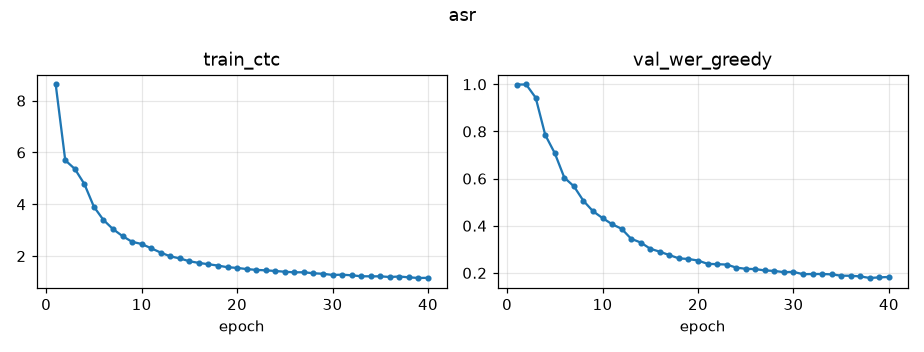

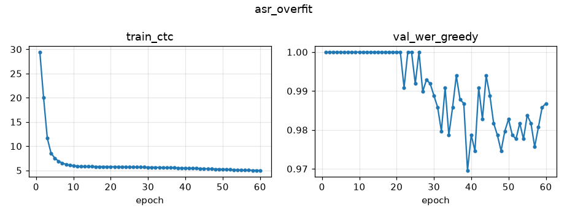

Metrics: `docs/metrics/asr.json`

---

## Stage 7: Disfluency CRNN

## Task

Audio-side hesitation: filled pause, repetition, prolongation, block in each 3 s window of the candidate's speech (counts feed the behaviour JSON and the hesitation index).

## Architecture

| | |
| --- | --- |
| front end | 80-band log-mel, per-clip normalisation, SpecAugment (train) |
| network | 4 conv blocks -> BiGRU(96) -> attention pooling -> 4 sigmoid outputs |
| parameters | 1,008,357 |

## Training data

SEP-28k (podcast clips, label present when >= 2 of 3 annotators marked it), split by episode; class-balanced BCE (pos_weight). Our hesitation spans are added once labelled.

## Results (test episodes)

| | |
| --- | --- |
| filler F1 / AUC | 0.6935 / 0.8784 (always-yes F1 0.3966) |
| repetition F1 / AUC | 0.4253 / 0.7103 (always-yes F1 0.337) |
| prolongation F1 / AUC | 0.4463 / 0.856 (always-yes F1 0.1728) |
| block F1 / AUC | 0.3034 / 0.6791 (always-yes F1 0.2135) |

## Limitations

- SEP-28k is mostly people who stutter, recorded on podcasts; Indian-English fillers such as 'matlab' are covered by the text-side rules until our labelled answers are added.
- Blocks and prolongations are rare in interviews; their F1 is reported for completeness.

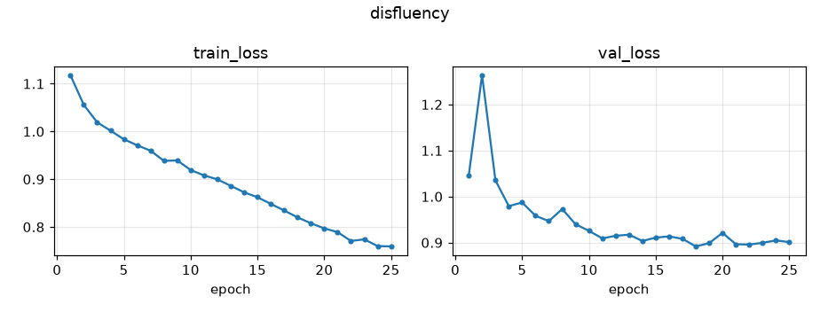

Metrics: `docs/metrics/disfluency.json`

---

## Stage 7: Speaking pattern + hesitation index

## Task

Per answer: speaking pattern (confident / balanced / hesitant / rushed / monotone) and a 0-100 hesitation index; inputs come from the pause model, prosody extractor and text/audio hesitation.

## Models

| | |
| --- | --- |
| speaking pattern | MLP 2 x 64, class-weighted CE |
| hesitation index | 100 * sigmoid(b + sum softplus(w_i) x_i) (monotone, interpretable) vs MLP |

## Data

synthetic answers, person-wise split (2255 / 451 / 473) - SYNTHETIC; re-train on our labels with the same script once sessions are labelled.

## Results (test)

| | |
| --- | --- |
| speaking pattern macro-F1 | 0.8098 |
| majority baseline | 0.1129 |
| hesitation index MAE (weighted sum) | 4.317 |
| hesitation index MAE (MLP) | 2.796 |
| mean baseline MAE | 13.84 |

## Largest hesitation weights

filler_rate_per_100w 0.33, disfluency_rate_per_100w 0.22, prolongation_count 0.12, response_latency_s 0.11, repetition_count 0.10

## Text hesitation rules vs dataset counts (Pearson r)

| | |
| --- | --- |
| filler_count | 0.8183 |
| repetition_count | 0.9604 |
| restart_count | 0.9434 |
| hedge_count | 0.8684 |

Metrics: `docs/metrics/behaviour.json`

---

## Stage 8: Answer-quality transformer

## Task

From the question and the answer transcript: relevance 0-1, quality 1-5, STAR components (behavioural questions), completeness, follow-up yes/no and reason.

## Architecture

| | |
| --- | --- |
| encoder | 4 pre-norm transformer layers, d_model 256, 4 heads, FF 1024 |
| input | [CLS] question [SEP] answer, SentencePiece answer vocabulary (ours), segment embeddings |
| parameters | 3,520,018 |

## Training data

synthetic labelled answers (person-wise split) + synthetic off-topic pairs (question with another question's answer). SYNTHETIC for now.

## Results (test) - transformer vs TF-IDF baseline

| | |
| --- | --- |
| relevance_mae | 0.0672 vs 0.0719 |
| relevance_r | 0.9477 vs 0.9248 |
| quality_accuracy | 0.6913 vs 0.5814 |
| quality_mae | 0.3907 vs 0.4546 |
| quality_qwk | 0.8574 vs 0.7726 |
| follow_up_f1 | 0.8829 vs 0.8523 |
| reason_macro_f1 | 0.5485 vs 0.4981 |

## Off-topic check

mean predicted relevance 0.0982, 97% flagged for follow-up

## Notes

- The synthetic answers are built from key-point sentences, so bag-of-words baselines are strong; the gap to the transformer should be re-measured on our transcripts.
- MIT Interview transcripts (on request) are added through answers_table once converted.

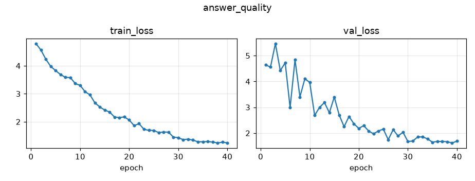

Metrics: `docs/metrics/answer_quality.json`

---

## Stage 8: Multimodal fusion

## Task

Communication effectiveness 0-100 with clarity, confidence, engagement, relevance and fluency sub-scores, follow-up yes/no + reason, with the top-3 reasons for every score.

## Architecture

| | |
| --- | --- |
| encoders | one MLP per modality (vision, prosody, hesitation, content, conversation) -> 64-d token |
| fusion | learned query, 4-head attention over modality tokens (weights = modality importance) + mean pool |
| heads | 6 sigmoid scores, follow-up logit, 6-way reason |
| parameters | 85,837 |
| regularisation | dropout 0.3, modality dropout 0.15 |

## Data

synthetic answers, person-wise split; content modality = out-of-fold answer-model outputs. SYNTHETIC for now: retrain on MIT Interview ratings + our labels with the same script.

## Ablation (test, effectiveness MAE / follow-up F1)

| | |
| --- | --- |
| video only | 10.712 / 0.7474 |
| audio only | 7.818 / 0.7896 |
| text only | 8.169 / 0.8765 |
| all modalities | 5.876 / 0.9586 |

## Baselines

| | |
| --- | --- |
| ridge_effectiveness_mae | 5.709 |
| mean_effectiveness_mae | 12.486 |

## All modalities (test)

| | |
| --- | --- |
| effectiveness MAE | 5.876 |
| Pearson r | 0.8917 |
| follow-up F1 | 0.9586 |
| reason macro-F1 | 0.6367 |
| mean modality attention | {'vision': 0.20469999313354492, 'prosody': 0.05979999899864197, 'hesitation': 0.10189999639987946, 'content': 0.5889999866485596, 'conversation': 0.044599998742341995} |

## Explanations

Shapley values by permutation sampling (48 orderings) -> templates (ml/fusion/explain.py); 100% of test answers get 3 reasons (examples: docs/metrics/fusion_explanations.json).

## Use

Decision support for the interviewer, never an automatic reject.

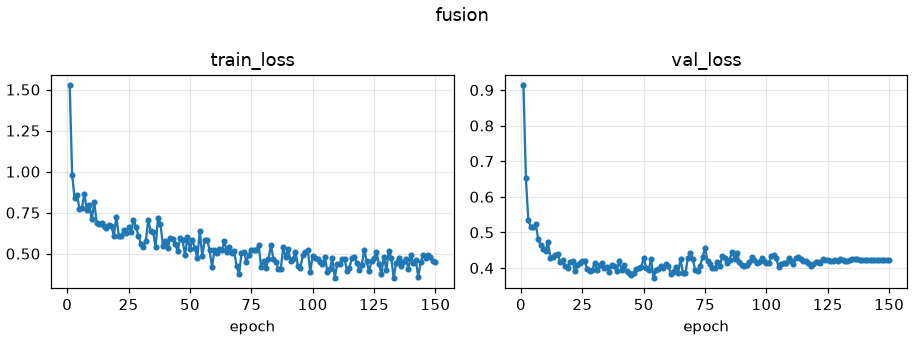

Metrics: `docs/metrics/fusion.json`

---

## Stage 8: Meeting head

## Task

Meeting mode: engagement 0-1 and contribution balance 0-1 per participant, from talk share, relative turn features and (camera on) on-screen ratio, face motion, head movement, multitasking share.

## Model

MLP 2 x 32 on standardised features; trained with camera-off copies so it works audio-only.

## Data

synthetic meetings (participants split person-wise); generalisation test on AMI (171 real meetings).

## Results

| | |
| --- | --- |
| synthetic test engagement MAE | 0.0381 |
| synthetic test balance MAE | 0.0283 |
| AMI balance MAE (relative features) | 0.0317 |
| AMI balance MAE (absolute features, first try) | 0.1201 |

## Finding

Absolute turn rate and turn length did not transfer from the simulator to real meetings (AMI turns are 3-6x shorter); within-meeting relative turn features fixed most of the drop.

Metrics: `docs/metrics/meeting_head.json`

---

## Failure cases and limitations

- Webcam vision models are pre-trained on public photos (WIDER, MPIIGaze); dim and backlit webcams and strong glasses reflections are the main failure cases until our recordings are added.
- The answer, behaviour and fusion models are trained on the SYNTHETIC dataset; their scores show that the pipeline learns, not how well it rates real candidates. Re-train on our labelled sessions with the same scripts.
- The ASR is trained on ~100 h of read English; spontaneous Indian-English interview speech is harder (see the per-accent WER rows once our sessions are transcribed).
- Bias check across gender, accent and glasses: docs/bias_check.md.
